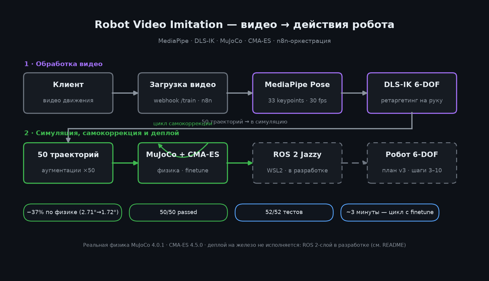

# Robot Video Imitation

Видео → действия робота: пайплайн превращает видео движения человека в 50 траекторий 6-DOF манипулятора, прогоняет их в реальной физике MuJoCo и **самокорректируется** через CMA-ES, пока траектории не пройдут порог. Оркестрация — n8n; деплой на робота — честная заглушка (ROS 2-слой в разработке).

> ⚠️ **Дисклеймер:** `/deploy` — заглушка (политика возвращается с sha256-хендшейком, на железо не исполняется). ROS 2-слой (Jazzy, WSL2) — следующий этап; этот репозиторий не требует WSL и полностью работает на Windows.

## Что умеет

- **Видео → скелет → траектории**: MediaPipe Pose (33 keypoints) → DLS-IK ретаргетинг на 6-DOF руку → 50 аугментаций (шум, скорость 0.7–1.3×, амплитуда)
- **Реальная симуляция**: MuJoCo 4.0.1 — сервоприводы 120 Гц, контакты/коллизии, детерминизм; метрики pose_error / jerk / коллизии
- **Самокоррекция**: CMA-ES 4.5.0 над 72-dim Фурье-политикой; кандидаты вне vel/acc-лимитов отбрасываются; итерации повторяются до порога
- **Оркестрация n8n**: 25-узловой workflow — батчи по 10, ретраи эпизодов, fan-out/fan-in, error-ветка, JSONL-журнал итераций
- **Единый источник лимитов**: MJCF-модель — канон кинематики/position; `limits.yaml` — vel/acc/watchdog; consistency-тесты скрепляют MJCF ↔ limits ↔ URDF ↔ контроллеры

## Метрики

| | |
|---|---|
| **Самокоррекция (строгий порог 2.0°)** | iter1 pe **2.71°** (1/50) → finetune → iter2 **1.72°** (50/50) — **−37% за одну итерацию** |
| **Живой прогон (порог 8°)** | **50/50 passed**, 0 коллизий, деплой с 1-й итерации (свежий re-run 19.11: pe 2.73°, deploy `131a1b23…`) |
| **Тесты** | **52/52** (IK, метрики, MuJoCo-физика, CMA-ES, консистентность источников) |
| **Живые исполнения n8n** | 9 успешных полных циклов через `POST /webhook/train` (0 ошибок нод) |

## Стек

- **Python 3.12**: numpy, MuJoCo 4.0.1, CMA-ES 4.5.0, PyYAML; MediaPipe — опционально (для `--video`)
- **n8n** (2.44.5): HTTP-воркер (`mock_worker.py`, порт 8000) + workflow без Python-нод
- **План (не в этом репо): ROS 2 Jazzy** в WSL2 — safety filter (C++), gateway, mujoco_ros2_control

## Архитектура



1. **Из видео — 50 траекторий**: Видео → MediaPipe Pose → DLS-IK 6-DOF → 50 аугментаций
2. **Симуляция и самокоррекция**: n8n батчит по 10 → MuJoCo `/simulate` → `/check_episode` → не пройден → CMA-ES `/finetune` → повтор итерации; пройден → `/deploy` (заглушка)

Подробно об n8n-воркфлоу (узлы, приёмы SplitInBatches, ретраи, JSONL): [docs/README_n8n.md](docs/README_n8n.md); сам граф — [workflow/n8n-training-pipeline.json](workflow/n8n-training-pipeline.json).

## Структура репозитория

```
├── README.md
├── LICENSE (MIT)
├── requirements.txt
├── pose_to_trajectories.py   ← видео → IK → 50 траекторий + метрики
├── mock_worker.py            ← HTTP-воркер: simulate (MuJoCo), finetune (CMA-ES), deploy
├── conftest.py, config.yaml
├── models/arm_6dof.xml       ← MJCF: канон кинематики и position-лимитов
├── config/limits.yaml        ← канон vel/acc/watchdog
├── tests/                    ← 52 теста (7 файлов)
├── workflow/n8n-training-pipeline.json  ← экспорт живого workflow (25 узлов)
├── docs/README_n8n.md        ← гайд по n8n-части
├── docs/architecture.png
└── examples/output_demo_metrics.json    ← метрики демо-прогона
```

## Быстрый старт

```bash
python -m venv venv && venv\Scripts\activate      # Windows
pip install -r requirements.txt

python pose_to_trajectories.py --demo             # синтетический скелет, без mediapipe
python mock_worker.py                             # воркер на :8000
pytest                                            # 52 теста
```

Для n8n: импортируйте `workflow/n8n-training-pipeline.json`, задайте `TRAINING_WORKER_URL=http://127.0.0.1:8000`, активируйте и `POST /webhook/train {"video_url":"demo://"}` — детали в [docs/README_n8n.md](docs/README_n8n.md).

## Ограничения и дальнейшие шаги

- `/deploy` — заглушка: возвращает политику + sha256, не исполняет на железе (честно зафиксировано)
- ROS 2-слой в разработке (план v3, шаги 3–10): safety core C++ → proxy action server → mujoco_ros2_control → gateway HTTP → полный цикл в WSL2
- Warm-start CMA-ES живёт в памяти воркера — рестарт воркера сбрасывает политику
- `pose_landmarker_full.task` (~9 МБ) не в репо — MediaPipe скачивает его автоматически

## Лицензия

MIT — см. [LICENSE](LICENSE).
